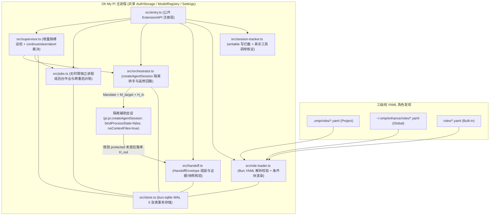

# `omp-enhance` 整体架构设计

`omp-enhance` 是一套构建在 **Oh My Pi (`omp`)** 公开扩展接口与官方 SDK 之上的第一性通用 Agent 协同内核。系统摒弃了“进程内过度防御胶水”和“多租户预扣费/硬超时”历史包袱，将全部机制收敛为两个正交范式：**角色内规范条件化 ($M_r$)** 与 **马尔可夫屏障交接包络 ($H$)**。

---

## 1. 第一性设计公理

1. **条件概率收窄公理（Role Conditioning）**
   未经规范约束的通用模型在宽泛的高熵边缘分布 $P(y \mid x)$ 上采样；而为角色 $r$ 施加结构化内规范 $M_r$（认知立场 + 有序方法步骤 + 物理工具与路径边界 + 准出判据），等价于将推理与动作约束在条件分布 $P(y \mid x, M_r)$ 上。当不同先验（如构造性的 `dev` 与证伪性的 `qa`）组合时，误差分布相互正交，判断准确度显著提升。
2. **马尔可夫交接屏障公理（Markov Handoff Barrier）**
   跨主体流转时，**必须直传**原始用户需求契约（`Mandate`）、自动计算的真实文件快照（`sha256`）与已核验执行证据；**必须截断**上游冗长的试错对话与自我辩护过程，防止下游角色产生同源锚定偏见。
3. **日常与多 Agent 同构公理（Single-Multi Duality）**
   日常单 Agent 工作（`N = 1`）与多角色接力协同（`N > 1`）完全遵循同一套 $(M_r, H)$ 算子：日常模式是单次态射（交接对象为用户），协同模式是态射的链式或回路复合（交接对象为下一角色，支持 `rejected` 打回返修）。
4. **个人主权公理（Sovereign Operation）**
   模型选择权与任务启停权完全归用户：100% 继承 OMP 已登录账号与设置；费用与工作时长仅做被动实测统计，**不设任何预扣美元上限或源头硬超时强杀**，仅以“连续相同错误无进展熔断（Stagnation Guard）”防止无人看管死循环。

---

## 2. 模块拓扑与职责划分



| 模块 | 核心职责 | 严守边界 |
| --- | --- | --- |
| `src/types.ts` | 全系统唯一共享的纯数据类型契约 | 无运行时副作用 |
| `src/store.ts` | `bun:sqlite` WAL 事务存储 + 工作区 glob `sha256` 快照比对 | 单一事实源，替代手搓文件锁 |
| `src/role-loader.ts` | `Bun.YAML.parse` 解析校验、三级目录合并、条件块渲染、YAML 序列化与 Copy-on-Write 角色保存/重置 | 零第三方解析库依赖 |
| `src/settings.ts` | 实时读取 OMP 原生插件设置（`omp-plugins.lock.json` / `.omp/plugin-overrides.json` / `.omp/enhance.yaml`）与角色模型解析（`@advisor` 默认继承） | 与系统内置 `/settings → Plugins` 无缝互通 |
| `src/role-studio.ts` | 内聚在 `/role` 命令下的原生 TUI 角色工作台（模型选择、工具 Checkbox 复选框、拷贝/自定义删除、YAML 在线校验编辑） | 100% 基于公开 `ExtensionUIContext`，零新增斜杠命令 |
| `src/flow-room.ts` | 双流协同房间状态机、左右对称群聊气泡排版（`Bun.stringWidth` 精准 CJK 对齐）、主窗口 `aboveEditor` 实时悬停条、`omp-enhance-room` 可折叠卡片渲染器与 `/flow` 双栏动作检查器 | 100% 基于公开 `setWidget`、`registerMessageRenderer` 与 `ui.custom` |
| `src/session-tracker.ts` | `tool_call` 写路径边界守卫 + `tool_execution_end` 真实调用留痕与可读工具摘要 | 不阻断合法原生操作 |
| `src/handoff.ts` | 校验证据引用与准出要求，自动扫描改动文件指纹，生成 `HandoffEnvelope` | 严禁模型手抄伪造哈希或调用 ID |
| `src/orchestrator.ts` | 派生零历史污染的下游角色会话（支持角色级异构模型与推理档位绑定），核验 `protected` 不变性，驱动返修回路与无进展熔断 | 仅调用官方根导出 `pi.pi.createAgentSession` |
| `src/jobs.ts` | 脱离终端生命周期的后台长作业（训练/批量实验）启动、日志归档、跨重启对账与取消 | 无预设时间上限强杀 |
| `src/supervisor.ts` | 周期性采集增量脉搏（默认继承 `@advisor` 模型角色），解析 `continue`/`steer`/`abort` JSON 裁决；同时服务后台作业 watch 与角色子会话 | 监督模型故障时 fail-open；仅凭真实增量证据止损 |
| `src/entry.ts` | 绑定 OMP 公开 `ExtensionAPI`（状态栏徽标、钩子、4 个工具、原位斜杠命令集） | 零 `@oh-my-pi/` 内部私有子路径导入 |

---

## 3. OMP 官方公开契约映射

插件仅依赖以下公开接口，确保跨 OMP 小版本升级（如 `18.20.x -> 18.22.x+`）稳定运行：

1. **`pi.on("before_agent_start")`**：在每轮模型请求前注入紧凑条件块（当前激活 `RoleSpec` + 有效 `Mandate` + 认知黑板活跃项 + 最近交接摘要），免疫上下文自动压缩导致的要求遗忘。
2. **`pi.on("tool_call")`**：对 `write`、`edit`、`apply_patch` 检查当前角色 `permissions.writable` 白名单，越界直接返回 `{ block: true, reason }`。
3. **`pi.on("tool_execution_end")`**：记录本轮真实完成的工具调用 ID 与错误状态，作为交接证据校验依据。
4. **`pi.setActiveTools`**：切换角色时动态收敛主会话可用工具范围（保留 `enhance_*` 伴随工具）。
5. **`pi.pi.createAgentSession`**：在进程内派生独立下游角色会话，传入 `modelRegistry: ctx.modelRegistry`、`model: ctx.model`、`thinkingLevel: pi.getThinkingLevel()`、`settings: pi.pi.settings`、`bindProcessState: false`、`disableExtensionDiscovery: true`、`noContextFiles: true`，实现 **100% 继承已登录 `/login` OAuth 账号与模型设置** 的同时彻底隔离对话上下文。
6. **受保护目录防逃逸（Post-Run Snapshot Seal）**：针对拥有 `bash` 工具的角色（如需要运行 `bun test` 的 `qa`），在子会话运行前后对 `permissions.protected`（如 `src/**`）做 `sha256` 快照比对；若字节发生变动，直接判定违约拒收。

---

## 4. 运行期自适应监督（Adaptive Supervisor）

长耗时本身绝不构成中断理由。`src/supervisor.ts` 用内置只读角色 `roles/supervisor.yaml` 周期性消费一个紧凑脉搏 `SupervisorPulse`：

| 字段 | 含义 |
| --- | --- |
| `targetKind` | `job`（后台进程组）或 `role_session`（角色子会话） |
| `goal` | 原始 `Mandate.goal`，防止巡检偏离真实目标 |
| `checkNumber` / `elapsedSec` / `idleSec` | 第几次巡检、总耗时、距最近增量输出的静默时长 |
| `deltaBytesOrCalls` / `deltaSummary` | 本周期新增日志字节或工具调用数，以及最近调用/错误摘要与有界日志尾部摘录（最多 800 字符） |

监督模型被要求只输出一个 JSON 对象：

```json
{ "action": "continue", "reason": "...", "nextCheckSec": 60, "evidence": "...", "steerMessage": "..." }
```

- `continue`：正常推进，按 `nextCheckSec`（钳制到 `[5, 600]` 秒）自适应拉长下次巡检。
- `steer`：将 `steerMessage` 注入角色子会话（`session.steer`）纠偏，不终止任务。
- `abort`：必须给出非空异常依据；后台作业调用 `cancelJob` 终止整个进程组，角色会话调用 `session.abort()`，流程状态返回 `aborted_by_supervisor`。

安全语义：初始延迟默认 30 秒，快速任务在首次巡检前结束即产生 **0 次**监督模型调用；监督模型调用或 JSON 解析失败时保持任务继续运行，并按 30 秒（受配置上下限钳制）后重试，**永不因监控自身故障误杀健康任务**。后台作业通过 `enhance_job` 的 `watch` 动作接入，角色链路通过 `executeRoleStep` / `executeRoleFlow` 的 `supervisor` 配置接入。
