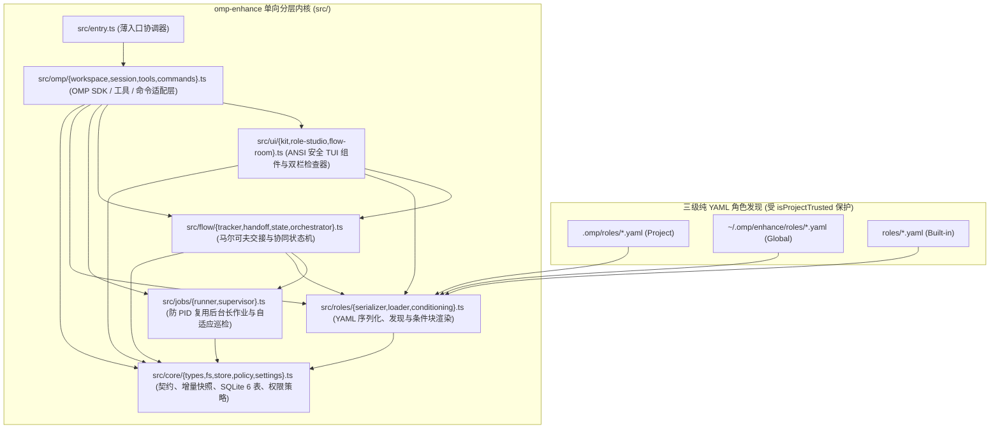

# `omp-enhance` 整体架构设计

`omp-enhance` 是一套构建在 **Oh My Pi (`omp`)** 公开扩展接口与官方 SDK 之上的第一性通用 Agent 协同内核。系统将全部机制收敛为两个正交范式：**角色内规范条件化 ($M_r$)** 与 **马尔可夫屏障交接包络 ($H$)**，并通过严格的单向分层架构保证高内聚与可验证性。

---

## 1. 第一性设计公理

1. **条件概率收窄公理（Role Conditioning）**
   未经规范约束的通用模型在宽泛的高熵边缘分布 $P(y \mid x)$ 上采样；而为角色 $r$ 施加结构化内规范 $M_r$（认知立场 + 有序方法步骤 + 物理工具与路径边界 + 准出判据），等价于将推理与动作约束在条件分布 $P(y \mid x, M_r)$ 上。当不同先验（如构造性的 `dev` 与证伪性的 `qa`）组合时，误差分布相互正交，判断准确度显著提升。
2. **马尔可夫交接屏障公理（Markov Handoff Barrier）**
   跨主体流转时，**必须直传**原始用户需求契约（`Mandate`）、自动计算的真实文件快照（`sha256` 产物与已删除文件清单）、已核验事实（`verifiedFacts`）、用户在途插话及真实执行证据；**必须截断**上游冗长的试错对话与自我辩护过程，防止下游角色产生同源锚定偏见。
3. **日常与多 Agent 同构公理（Single-Multi Duality）**
   日常单 Agent 工作（`N = 1`）与多角色接力协同（`N > 1`）完全遵循同一套 $(M_r, H)$ 算子与权限策略（`src/core/policy.ts`）：日常模式是单次态射（交接对象为用户），协同模式是态射的链式或回路复合（交接对象为下一角色，支持 `rejected` 打回可写上游返修）。
4. **个人主权公理（Sovereign Operation）**
   模型选择权与任务启停权完全归用户：100% 继承 OMP 已登录账号与设置；实测 Token 与费用被动统计至交接包，**不设任何预扣美元上限或源头硬超时强杀**，在多角色返修回路中以“连续相同打回原因无进展熔断（Stagnation Guard）”防止无人看管死循环。

---

## 2. 六层单向 DAG 模块拓扑

`scripts/check-loc.ts` 在 CI/本地检查中静态强制以下单向分层依赖（`core ← roles / jobs ← flow ← ui ← omp ← entry.ts`）与单文件 `≤ 450` 行门禁：

| 层级与模块 | 核心职责 | 严守边界 |
| --- | --- | --- |
| `src/core/types.ts` | 全系统唯一共享纯数据类型契约 | 零外部模块依赖与运行时副作用 |
| `src/core/fs.ts` | 遵循 `.gitignore` 的增量元数据缓存 `sha256` 快照、符号链接真实路径校验与 `.omp/` 配置完整性封印 | 跳过超大二进制与虚拟环境目录，杜绝阻塞主线程 |
| `src/core/store.ts` | `bun:sqlite` WAL + `busy_timeout = 5000` 6 张表事务存储、外键级联、会话/流程级 `Mandate` 作用域与进程启动指纹校验 | 关闭后拒绝幽灵重开覆写检查点 |
| `src/core/policy.ts` | 工具激活集合计算、伴随工具防提权校验、`write`/`edit`/`apply_patch`/`ast_edit` 闭环守卫与惰性 `TurnTracker` | 前台与子会话共享单一权限真源，启动零磁盘阻塞 |
| `src/core/settings.ts` | 读取 OMP 原生插件设置（支持 `--profile` 与父目录覆盖，受 `isProjectTrusted` 门禁保护）、`@<role>:thinking` 后缀解析（含 `max`/`auto`）及用量归一化 | 与系统内置 `/settings → Plugins` 无缝互通 |
| `src/roles/{serializer,loader,conditioning}.ts` | 无损 YAML 序列化（`|2` 缩进与标量防强转）、单文件故障隔离加载（支持符号链接角色文件）、防标签逃逸条件块渲染 | 单个损坏 YAML 绝不拖垮宿主钩子 |
| `src/jobs/{runner,supervisor}.ts` | 环境变量隔离的原子 `.exit` 后台作业执行、防 PID 复用批量信号终止（`SIGTERM → SIGKILL` 升级）、尾部定位日志读取与竞态安全自适应巡检 | 仅依赖 `core/`，与宿主 SDK 解耦 |
| `src/flow/{tracker,handoff,state,orchestrator}.ts` | 落库前读写边界封印校验（`BoundaryViolationError`）、带属主 PID 保护的 `FlowRoomManager` 纯状态机与多角色返修编排 | 违约状态禁止写入脏交接包或断点续跑 |
| `src/ui/{kit,role-studio,flow-room}.ts` | Kitty CSI-u 键盘解析、ANSI 安全截断折行、带滚动视窗的 Role Studio 与 `/flow` 双栏群聊检查器 | 纯 UI 渲染，不含 SQLite 或子进程逻辑 |
| `src/omp/{workspace,session,tools,commands}.ts` & `src/entry.ts` | 封装 `SessionManager.inMemory` 子任务隔离会话派生、会话模型基线还原、带 `AbortSignal` 透传的 4 个工具与斜杠命令 | 零 `@oh-my-pi/` 私有子路径导入；不覆盖原生 `/handoff` |

---

## 3. OMP 官方公开契约映射

插件仅依赖以下公开接口，确保跨 OMP 版本稳定运行：

1. **`pi.on("before_agent_start")`**：在每轮模型请求前注入转义安全的条件块（当前激活 `RoleSpec` + 当前会话有效 `Mandate` + 认知黑板活跃项 + 最近交接摘要/已验证事实/删除文件），免疫上下文自动压缩导致的要求遗忘。
2. **`pi.on("tool_call")`**：通过 `src/core/policy.ts` 对写操作（解析真实符号链接路径，无法提取路径时 fail-closed 阻断）、子代理派生及伴随工具（禁止只读角色调用启动型 `enhance_job` 或提权委托可写角色）执行统一拦截。
3. **`pi.on("tool_execution_end")`**：记录本轮真实工具调用起止状态与错误标记，供运行期脉搏与交接证据校验使用。
4. **`pi.setActiveTools` / `pi.setModel` / `pi.setThinkingLevel`**：按会话快照保存初始模型与推理档位，切换角色时动态收敛工具并应用角色专属模型，切回 `inherit` 或 `/role off` 时精准还原。
5. **`pi.pi.createAgentSession`**：派生子角色会话与监督检查会话时，显式传入 `sessionManager: pi.pi.SessionManager.inMemory(cwd)`、`hasUI: false`、`restrictToolNames: true`、`bindProcessState: false`、`disableExtensionDiscovery: true`、`noContextFiles: true`，既 **100% 继承已登录账号与模型配置**，又避免向 `~/.omp/agent/sessions/` 写入临时 `.jsonl` 会话文件或清除父级自定义模型注册源。
6. **落库前全量边界封印（Pre-Save Boundary & Config Seal）**：在 `createAndVerifyHandoff` 落库前同时核验 `permissions.protected`、`permissions.writable` 以及 `.omp/` 配置目录完整性哈希；一旦越界直接抛出违约错误，绝不污染 SQLite。

---

## 4. 运行期自适应监督（Adaptive Supervisor）

长耗时本身绝不构成中断理由。`src/jobs/supervisor.ts` 配合 `src/omp/session.ts` 中的无工具轻量巡检器周期性消费紧凑脉搏 `SupervisorPulse`：

| 字段 | 含义 |
| --- | --- |
| `targetKind` | `job`（后台进程组）或 `role_session`（隔离角色子会话） |
| `goal` | 原始任务或 `Mandate.goal` |
| `checkNumber` / `elapsedSec` / `idleSec` | 第几次巡检、真实总耗时（已运行作业按 `job.startedAt` 计算）、距最近增量输出、活跃工具或后台异步任务的静默时长 |
| `deltaBytesOrCalls` / `deltaSummary` | 本周期新增日志字节或已完成工具调用数；日志尾部包裹在 `untrusted_log_tail: <<<...>>>` 定界符内防止提示词注入 |
| `roleId` / `readOnly` / `allowedTools` | 角色子会话的身份与工具边界元数据（对只读或无 `bash` 阶段严禁误导执行 Shell 命令） |
| `activeTool` / `activeAsyncJobs` / `priorDecisions` | 当前正在执行的长耗时工具、OMP 原生后台异步任务数（`bg_*` 运行期计为活跃进展），以及最近 5 次巡检裁决历史（防止无记忆重复 `steer`） |

监督模型严格输出单个 JSON 对象（支持平衡花括号扫描提取）：

- **针对角色子会话 (`role_session`)**：允许 `continue`、`steer`（附带 `[Supervisor]:` 前缀注入 `session.steer`）或 `abort`（调用 `session.abort()`）。
- **针对后台作业 (`job`)**：因后台进程无交互式标准输入，提示词与协议仅开放 `continue` 或 `abort`（校验进程启动指纹后终止进程组并支持 `SIGTERM → SIGKILL` 升级）。

安全与竞态保证：
- 初始延迟默认 30 秒，快速任务在首次巡检前结束即产生 **0 次**监督模型调用；当 `supervisorEnabled = false` 时，`enhance_job(action="watch")` 仅执行本地完成状态对账而不触发监督模型。
- 巡检请求全程与目标任务完成事件及工具 `AbortSignal` 竞态绑定（`Promise.race`）：一旦子会话或后台作业在监督请求飞行途中已正常收尾，立即采纳真实完成结果，**绝不允许滞后的 `abort` 裁决覆盖已完成的交接包**。
- 监督模型报错或返回非法 JSON 时 **fail-open**，并按 `30s → 60s → 120s...`（钳制在 `[5, 600]` 秒）指数退避重试，既不误杀健康任务，也避免故障期间高频空刷模型配额。
