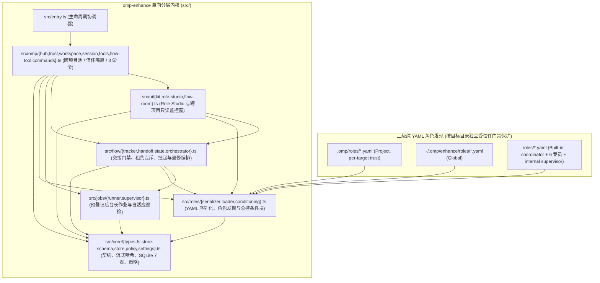

# `omp-enhance` 整体架构设计

`omp-enhance` 是构建在 **Oh My Pi (`omp`)** 公开扩展接口与官方 SDK 之上的第一性 **SuperAgent 单窗口跨项目协同内核**。系统默认保持 **100% 零侵入标准 OMP（`defaultRole: null` / `"off"`）**；当用户通过 `/coord` 激活总秘书模式后，全部多项目协同收敛为三个正交机制：**`Role × Project Context/Skills` 条件化 ($M_r \times C_{\text{cwd}}$)**、**马尔可夫屏障交接包络 ($H$)** 与 **带任务租约互斥的跨项目双向唤醒中枢（Multi-Project Hub）**。

---

## 1. 第一性设计公理

1. **零侵入与纯总控分离公理（Zero-Intrusion & Pure Dispatch）**
   未开启 `/coord` 且无后台活跃任务时，插件不注入任何系统提示词、不显示状态栏徽标、不收敛宿主原生工具，也不重写用户输入中的 `@` 符号。开启 `/coord` 后，前台 `coordinator` 持有 `permissions.dispatch = true` 与只读工具白名单（事前拦截一切直接文件写、Shell 命令、`enhance_job(start)` 与 `enhance_handoff`），专职与用户用自然语言对齐需求并向后台派发专员流水线，保持主会话上下文高信噪比。
2. **`Role × Project Context/Skills` 正交分解与诚实边界公理（Orthogonal Role Conditioning & Two-Layer Boundary）**
   将跨领域不变的**认知立场与目录权限边界（`RoleSpec`：`planner` / `dev` / `algo` / `qa` / `reviewer` / `vision`）**同项目特有的**技术栈与领域知识（`<targetCwd>/AGENTS.md`、`CLAUDE.md`、项目 `skills`、`rules` 与 `LSP`）**正交解耦。边界保护明确区分为两层：
   - **事前阻止**：编辑类工具（`write`/`edit`/`apply_patch`/`ast_edit`）在调用前解析真实符号链接路径并拦截任何非 `writable` 或命中 `protected` 的目标；子会话以 `restrictToolNames: true` + `preloadedPreparedExtensions` 严格收敛工具面。
   - **事后核验与拒收**：开放 `bash` 的角色在阶段结束交接时执行全目录内容摘要快照比对（`<= 512 MiB` 计算 64 KiB 分块流式 `sha256` 记为 `digestKind: "sha256"`；`> 512 MiB` 超大文件记录 `stat:<size>:<mtime>` 标为 `digestKind: "stat_fingerprint"`），一旦发现 `protected`、非 `writable` 或 `.omp/` 配置篡改，直接判为 `violation` 拒收且禁止续跑。若验收场景要求命令执行期间源码在操作系统层全程严格只读，应在隔离工作区副本或只读挂载目录下运行。
3. **马尔可夫交接屏障与零空耗挂起公理（Markov Barrier & Zero-Cost Suspension）**
   跨专员流转时，**必须直传**原始需求契约（`Mandate`）、自动核验的真实文件快照、行号在界内的已核验事实（`verifiedFacts`）、用户在途答复及真实执行证据；**必须截断**上游冗长试错对话。专员遇到关键业务分叉点时，以 `verdict: "needs_input"` + `questionsForUser` 将该 `flowId` 检查点挂起为 `waiting_input` 并释放项目执行租约（挂起期间 **0 Token 消耗**），待用户答复后按指定 `flowId` 无损续跑。
4. **个人主权与故障可区分公理（Sovereign Operation & Diagnostic Fidelity）**
   100% 继承 OMP 已登录账号与模型角色配置；实测用量被动统计，不设硬超时强杀。严格区分三类阶段异常：宿主/模型服务错误（如 `502 Bad Gateway` → `host_error`，Flow 记为可续跑的 `failed`）、正常结束未调用交接工具（`missing_handoff` → 可续跑的 `failed`）与真实越界篡改（`violation` → 不可续跑）。

---

## 2. 六层单向 DAG 模块拓扑

`scripts/check-loc.ts` 静态强制以下单向分层依赖（`core ← roles / jobs ← flow ← ui ← omp ← entry.ts`）、单文件 `≤ 450` 行与零 `@oh-my-pi/*/*` 私有子路径导入门禁：

| 层级与模块 | 核心职责 | 严守边界 |
| --- | --- | --- |
| `src/core/types.ts` | 共享纯数据类型契约（含 `dispatch`、`internal`、`digestKind`、`requiredTools`/`requiredArtifacts`、`host_error`/`missing_handoff`） | 零外部模块依赖与运行时副作用 |
| `src/core/fs.ts` | 遵循 `.gitignore` 的 64 KiB 分块流式 `sha256`（`<= 512 MiB`）与 `stat_fingerprint` 快照、符号链接真实路径校验与 `.omp/` 完整性封印 | 区分真实内容摘要与元数据指纹，杜绝阻塞或伪装哈希 |
| `src/core/{store-schema,store}.ts` | `bun:sqlite` WAL + `busy_timeout = 5000` **7 张表**事务存储（含 `project_leases` 执行互斥锁、按 `flowId` 精准留言/取消、自动写入 `.omp-enhance/.gitignore` `*`） | 纯读不建空库；`BEGIN IMMEDIATE` 跨进程防双跑 |
| `src/core/policy.ts` | `dispatch` 总控事前拦截、内部角色过滤、`write`/`edit`/`apply_patch`/`ast_edit` 路径守卫与 `0ms` 惰性 `TurnTracker` | 前台与子会话共享单一权限真源 |
| `src/core/settings.ts` | 读取 OMP 原生插件设置（默认 `defaultRole: null`、`flowRoutingMode: "auto"`，按目标目录独立校验 `isProjectTrusted`）及 `@<role>:thinking` 解析 | 与系统内置 `/settings → Plugins` 无缝互通 |
| `src/roles/{serializer,loader,conditioning}.ts` | 无损 YAML 序列化（含 `required_tools`/`required_artifacts`）、三级角色发现与 `coordinator` 在途负载条件块渲染 | 单个损坏 YAML 绝不拖垮宿主钩子 |
| `src/jobs/{runner,supervisor}.ts` | **先落库登记后派生进程**的原子 `.exit` 后台作业执行、启动异常可查记录、防 PID 复用信号终止（`cancelJobsByIds`）与竞态安全巡检 | 登记失败零副作用；启动失败可查询诊断 |
| `src/flow/{tracker,handoff,state,orchestrator}.ts` | 行号越界与准出交付物硬校验、纯只读审计与混合交付链打回区分、创建前后三段取消屏障、`project_leases` 租约守卫与 `host_error` 故障归类 | 恢复前预验角色与租约；未执行开发阶段绝不误标完成 |
| `src/ui/{kit,role-studio,flow-room}.ts` | Kitty CSI-u 键盘解析、ANSI 安全截断折行、纯配置导向 Role Studio 与跨项目只读 `/flow` 监控面板 | 纯 UI 渲染，不含草稿误触框、SQLite 或子进程逻辑 |
| `src/omp/{hub,trust,workspace,session,tools,flow-tool,commands}.ts` & `src/entry.ts` | 跨项目 `WorkspaceHub`、按目标目录独立的信任授权（`trusted-projects.json`）、按 `flowId` 精准路由、静默去重唤醒与 `/coord` / `/role` / `/flow` 三命令 | 零 `@oh-my-pi/` 私有导入；跨目录未确认信任前绝不启用对方 `.omp` 覆盖 |

---

## 3. 任务身份隔离、跨进程租约互斥与跨目录信任边界

1. **按 `flowId` 精准寻址与跨进程 SQLite 租约互斥（P1-1 & P1-2）**
   - 每个目标项目通过 `project_leases` 表（`BEGIN IMMEDIATE` 事务 + `owner_pid` / `owner_start_token` 存活核验）授予唯一活跃执行权：无论同一进程内多个实例还是两个独立 `omp` 终端同时向同一目录派单，最多只有一个 Flow 获得 `running` 执行权；属主进程崩溃后自动将其残留 `running` 记录转为 `interrupted` 并移交租约。
   - 当同项目的 Flow `A` 挂起于 `waiting_input`、随后启动 Flow `B` 时，通过 `enhance_flow` 或 `/flow cancel <flowId>` 按 `A` 的 ID 执行 `status`、`steer`、`cancel` 或 `resume` 均严格作用于 `A` 的检查点记录——绝不误读或误停正在运行的 `B`；若 `B` 仍持有租约时请求恢复 `A`，系统先保存用户对 `A` 的答复，再明确返回 `busy: true` 与当前占用者 `activeFlowId`，待 `B` 释放后 `A` 从原挂起阶段继续。
2. **创建前后三段取消屏障与恢复前预校验（P1-3 & P2-3）**
   子阶段在 `createAgentSession` 调用前、返回后（若已取消立即 `dispose()` 且零次 `prompt()`）及首轮模型执行中全程绑定取消信号，杜绝“取消已返回成功仍跑出首轮请求”。执行 `resume` 进入 `running` 状态与占用租约前，预先校验检查点可恢复性与整条 `roleChain` 角色完整性——若自定义角色已被误删，诊断报错的同时保持原检查点可重试且零租约残留。
3. **跨目录独立信任门禁（P1-6：`src/omp/trust.ts`）**
   从受信任主目录 `A` 跨目录派单至目录 `B` 时，绝不沿用 `A` 的信任状态：若宿主未对 `B` 提供路径级信任确认且用户未通过 `/coord trust <B>` 授权（持久化于 `~/.omp/enhance/trusted-projects.json`），`B` 默认以 `isProjectTrusted = false` 运行（仅加载内置与全局角色/设置，跳过 `B/.omp/*` 并给出明确提示）。
4. **静默去重唤醒与混合链完成判定（P1-4）**
   纯只读审计链（如单跑 `reviewer` 或 `planner → reviewer`）给出 `verdict: "rejected"` 时作为“审计完成且发现阻断项”收束为 `status: "completed"`；而包含待执行可写交付阶段的混合链（如 `planner → dev → qa` 中 `planner` 首轮返回 `rejected`）严禁提前宣称完成，统一进入 `status: "blocked"` 并保持 `Mandate` 为 `active`。后台事件通过 `display: false` + `pendingWakeups` 去重合并唤醒 `coordinator`。

---

## 4. 运行期自适应监督（Adaptive Supervisor）

内置隐藏角色 `supervisor`（`internal: true`、默认 `model: "@advisor"`、`thinking: "inherit"`）通过无工具轻量内存会话周期性消费 `SupervisorPulse`（含 `roleId` / `readOnly` / `allowedTools` / `activeTool` / `activeAsyncJobs` / `priorDecisions`）：对只读或无 `bash` 阶段严禁误导执行 Shell/测试命令；`bg_*` 原生后台任务运行期自动将 `idleSec` 置零；巡检全程与自然完成事件竞态绑定，报错时 **fail-open** 指数退避；阶段中止时通过 `cancelJobsByIds` 自动清理残留后台进程组。
