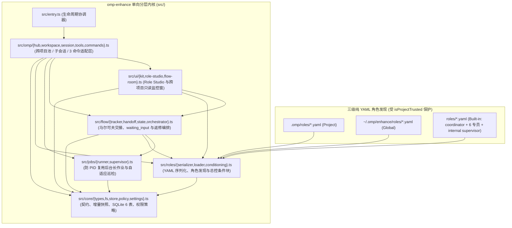

# `omp-enhance` 整体架构设计

`omp-enhance` 是构建在 **Oh My Pi (`omp`)** 公开扩展接口与官方 SDK 之上的第一性 **SuperAgent 单窗口跨项目协同内核**。系统默认保持 **100% 零侵入标准 OMP（`defaultRole: null` / `"off"`）**；当用户通过 `/coord` 激活总秘书模式后，全部多项目协同收敛为三个正交机制：**`Role × Project Context/Skills` 条件化 ($M_r \times C_{\text{cwd}}$)**、**马尔可夫屏障交接包络 ($H$)** 与 **双向异步唤醒中枢（Multi-Project Hub）**。

---

## 1. 第一性设计公理

1. **零侵入与纯总控分离公理（Zero-Intrusion & Pure Dispatch）**
   未开启 `/coord` 且无后台活跃任务时，插件不注入任何系统提示词、不显示状态栏徽标、不收敛宿主原生工具，也不重写用户输入中的 `@` 符号。开启 `/coord` 后，前台 `coordinator` 持有 `permissions.dispatch = true` 与纯只读物理锁（严禁直接写文件或执行命令），专职与用户用自然语言对齐需求并向后台派发专员流水线，保持主会话上下文始终高信噪比。
2. **`Role × Project Context/Skills` 正交分解公理（Orthogonal Role Conditioning）**
   将跨领域不变的**认知立场与物理权限边界（`RoleSpec`：`planner` / `dev` / `algo` / `qa` / `reviewer` / `vision`）**同项目特有的**技术栈与领域知识（`<targetCwd>/AGENTS.md`、`CLAUDE.md`、项目 `skills`、`rules` 与 `LSP`）**正交解耦。子阶段会话进入目标目录 `targetCwd` 时自动挂载该目录的上下文与技能（`noContextFiles: false`、`enableLsp` 按工具授权按需开启），同时以 `restrictToolNames: true` + `preloadedPreparedExtensions` 严格锁死角色物理权限边界。
3. **马尔可夫交接屏障与零空耗挂起公理（Markov Barrier & Zero-Cost Suspension）**
   跨专员流转时，**必须直传**原始需求契约（`Mandate`）、自动计算的真实文件快照（`sha256` 产物与已删除文件清单）、已核验事实（`verifiedFacts`）、用户在途答复及真实执行证据；**必须截断**上游冗长的试错对话，防止同源锚定偏见。当专员遇到关键业务分叉点时，以 `verdict: "needs_input"` + `questionsForUser` 将流程检查点挂起为 `waiting_input` 并立即释放会话（挂起期间 **0 Token 消耗**），唤醒 `coordinator` 向用户提问后再通过 `enhance_flow(action="resume", message=...)` 无损续跑。
4. **个人主权公理（Sovereign Operation）**
   模型选择权与任务启停权完全归用户：100% 继承 OMP 已登录账号与模型角色配置；实测 Token 与费用被动统计至交接包，**不设预扣额度锁或源头硬超时强杀**，以“连续相同打回原因无进展熔断（Stagnation Guard）”与 `@advisor` 运行期巡检防止无人看管死循环。

---

## 2. 六层单向 DAG 模块拓扑

`scripts/check-loc.ts` 静态强制以下单向分层依赖（`core ← roles / jobs ← flow ← ui ← omp ← entry.ts`）、单文件 `≤ 450` 行与零 `@oh-my-pi/*/*` 私有子路径导入门禁：

| 层级与模块 | 核心职责 | 严守边界 |
| --- | --- | --- |
| `src/core/types.ts` | 全系统共享纯数据类型契约（含 `dispatch`、`internal`、`needs_input`、`waiting_input`、`ArtifactRole: "inspected"`） | 零外部模块依赖与运行时副作用 |
| `src/core/fs.ts` | 遵循 `.gitignore` 的增量元数据缓存 `sha256` 快照、符号链接真实路径校验与 `.omp/` 配置完整性封印 | 跳过超大二进制与虚拟环境目录，杜绝阻塞主线程 |
| `src/core/store.ts` | `bun:sqlite` WAL + `busy_timeout = 5000` 6 张表事务存储（首次建库自动写入 `.omp-enhance/.gitignore` `*`）、外键级联、只读旧库迁移兼容与进程启动指纹校验 | 纯读不建空库、不脏写 WAL、不污染目标仓库 `git status` |
| `src/core/policy.ts` | `dispatch` 总控物理锁（拦截直接写/Shell/`enhance_job(start)`/`enhance_handoff`）、内部角色过滤、`write`/`edit`/`apply_patch`/`ast_edit` 闭环守卫与 `0ms` 惰性 `TurnTracker` | 前台与子会话共享单一权限真源，启动零磁盘阻塞 |
| `src/core/settings.ts` | 读取 OMP 原生插件设置（默认 `defaultRole: null`、`flowRoutingMode: "auto"`，受 `isProjectTrusted` 保护）及 `@<role>:thinking` 后缀解析（含 `max`/`auto`） | 与系统内置 `/settings → Plugins` 无缝互通 |
| `src/roles/{serializer,loader,conditioning}.ts` | 无损 YAML 序列化、三级发现（支持符号链接角色文件）、`coordinator` 专员名册与跨项目在途负载条件块渲染 | 单个损坏 YAML 绝不拖垮宿主钩子 |
| `src/jobs/{runner,supervisor}.ts` | 环境变量隔离的原子 `.exit` 后台作业执行、防 PID 复用批量信号终止（`cancelJobsByIds`）、尾部定位日志读取与竞态安全自适应巡检 | 仅依赖 `core/`，与宿主 SDK 解耦 |
| `src/flow/{tracker,handoff,state,orchestrator}.ts` | 落库前读写边界封印校验、未变文件 `[inspected]` 标注、纯只读审计 `rejected → completed` 收敛、`needs_input → waiting_input` 挂起续跑与多角色返修编排 | 违约状态禁止写入脏交接包或断点续跑 |
| `src/ui/{kit,role-studio,flow-room}.ts` | Kitty CSI-u 键盘解析、ANSI 安全截断折行、纯配置导向 Role Studio（专员不误切前台）与跨项目只读 `/flow` 监控面板 | 纯 UI 渲染，不含草稿误触框、SQLite 或子进程逻辑 |
| `src/omp/{hub,workspace,session,tools,commands}.ts` & `src/entry.ts` | 跨项目 `WorkspaceHub` 并发池（持久化 `~/.omp/enhance/hub-projects.json`）、去重静默唤醒闭环、精确延迟工具还原与 `/coord` / `/role` / `/flow` 三命令 | 零 `@oh-my-pi/` 私有导入；默认 `"off"` 100% 零侵入 |

---

## 3. 跨项目池（`WorkspaceHub`）与双向异步闭环

1. **单窗口跨项目并行调度与子项目记忆（Cross-Project Parallelism & `hub-projects.json`）**
   `src/omp/hub.ts` 按规范化目录路径池化管理多个 `ManagedWorkspace`，并将已派发过的从属项目路径按主工作区记录在 `~/.omp/enhance/hub-projects.json`（支持 `OMP_ENHANCE_HOME` 测试隔离，不在主项目内产生任何杂文件），重开 `omp` 后打开 `/flow` 仍可浏览各子项目进度。不同项目的后台专员流水线完全并行推进，同一目标项目内由 `targetWs.room.isRunning()` 保障单写者互斥安全；编辑器上方 `aboveEditor` 条按活跃项目紧凑汇总多项目实时状态，子阶段绝不抢占主窗口 `setWorkingMessage` 加载指示器。
2. **静默投喂与去重合并唤醒（`display: false` + `pendingWakeups` Deduplication）**
   后台 Flow 收敛至 `"completed"`（含纯只读审计 `reviewer` / `planner → reviewer` 给出 `verdict: "rejected"` 发现阻断问题时的正常完结）、`"waiting_input"`、`"failed"`、`"violation"` 或 `"aborted_by_supervisor"` 时，结构化报告以 `pi.sendMessage({ customType: "omp-enhance-flow-event", content, display: false, excludeFromContext: false }, { triggerTurn: shouldWake, deliverAs: "followUp" })` 静默注入 `coordinator` 上下文（终端只展示 1 张精炼群聊纪要卡片 + 总秘书的自然人话回复，绝不刷屏打印原始哈希墙）。若收敛时 `coordinator` 正处于当前轮回复途中（`ctx.isIdle() === false`），事件先缓存在 `hub.pendingWakeups`：若本轮 `coordinator` 已通过 `enhance_flow(action="status" | "list")` 读取过同一 `settlementKey` 结果则自动消重，未消费的多个跨项目事件在 `agent_end` 合并为单条 `followUp` 唤醒。
3. **子阶段隔离、项目上下文继承与延迟工具保护（`createOmpRoleSessionRunner` & `SessionBaselineManager`）**
   派生专员子会话时显式传入独立子任务身份（`agentId`、`parentTaskPrefix`、`taskDepth: 1`）、`sessionManager: SessionManager.inMemory(targetCwd)`、`restrictToolNames: true`、`allowRestrictedCustomTools: true`、`preloadedPreparedExtensions: [<enhance-guard>]`、`enableMemory: false`、`autoApprove: true`、`noContextFiles: false`、`enableLsp: allowedTools.includes("lsp")` 及禁用宿主原生 `advisor.enabled` / `autolearn` 的设置代理——既完整继承目标项目的 `AGENTS.md`、领域 `Skills` 与 `LSP`，又彻底杜绝污染 `~/.omp/agent/sessions/`、覆盖宿主 `AgentRegistry` `"main"` 或触发双 Advisor 干扰。前台开启 `/coord` 再切回 `/coord off` 时，`SessionBaselineManager` 精准还原进入前 `pi.getActiveTools()` 快照，绝不意外激活宿主的延迟加载工具。

---

## 4. 运行期自适应监督（Adaptive Supervisor）

内置隐藏角色 `supervisor`（`internal: true`、默认 `model: "@advisor"`、`thinking: "inherit"`）通过无工具轻量内存会话周期性消费 `SupervisorPulse`：

| 字段 | 含义 |
| --- | --- |
| `targetKind` / `goal` | `job`（后台进程组）或 `role_session`（隔离专员子会话）及原始 `Mandate.goal` |
| `checkNumber` / `elapsedSec` / `idleSec` | 第几次巡检、真实总耗时、距最近增量输出/活跃工具/后台异步任务的静默时长 |
| `deltaBytesOrCalls` / `deltaSummary` | 本周期新增日志字节或已完成工具调用数；日志尾部包裹在 `untrusted_log_tail: <<<...>>>` 定界符内防止提示词注入 |
| `roleId` / `readOnly` / `allowedTools` | 专员身份与工具权限边界（只读或无 `bash` 阶段严禁误导执行 Shell/测试命令） |
| `activeTool` / `activeAsyncJobs` / `priorDecisions` | 当前运行工具、OMP 原生后台异步任务数（`bg_*` 运行期自动将 `idleSec` 置零）及最近 5 次巡检历史 |

安全保证：初始延迟默认 30 秒（快任务产生 **0 次**监督调用）；巡检请求全程与任务自然完成事件竞态绑定（绝不让滞后 `abort` 覆盖已落盘交接包）；监督模型报错时 **fail-open** 并按 `30s → 60s → 120s...` 指数退避；阶段被中止时通过 `cancelJobsByIds` 自动清理该阶段启动的残留后台作业进程组。
